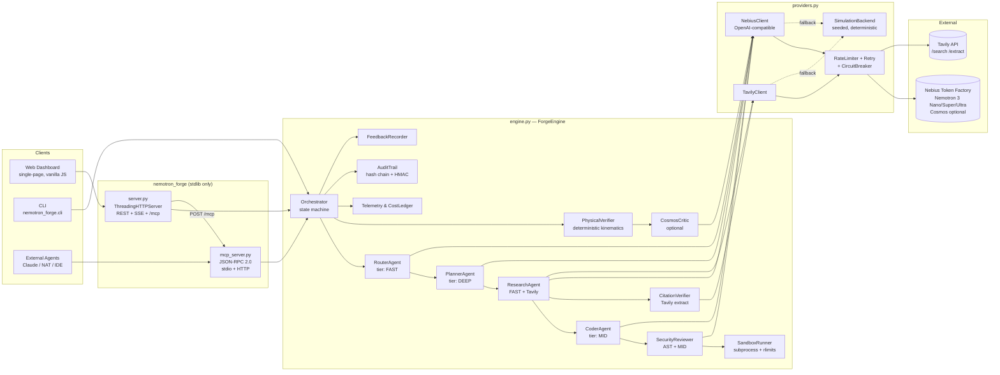
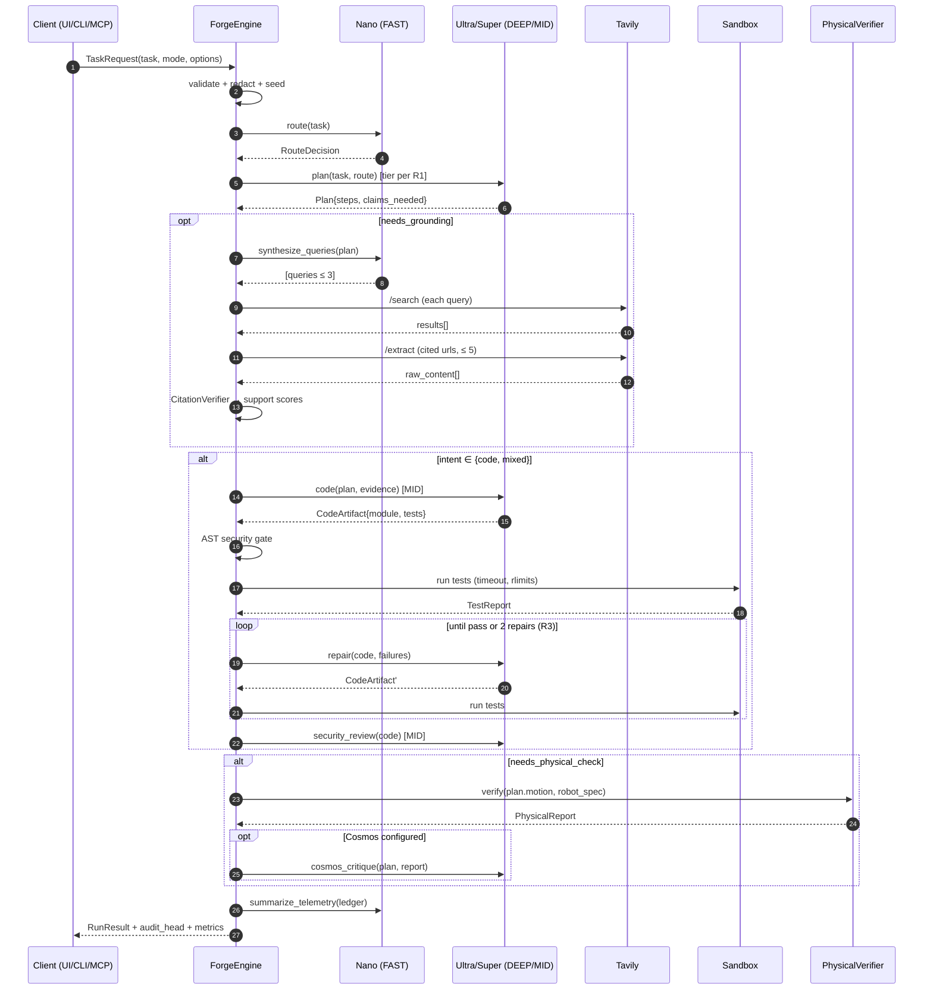

# DESIGN_OPUS55.md — Nemotron Forge

**Tiered Multi-Agent Orchestrator & Physical/Code Verification Studio on Nebius Token Factory**

| Field | Value |
|---|---|
| Document | Architecture & Implementation Design Specification |
| Package | `nemotron_forge` (Python ≥ 3.10, stdlib only at runtime) |
| Version | 1.0.0 (design freeze for hackathon submission) |
| Author | Kazutoshi Hayashi (`cal29292929`) |
| License | MIT |
| Event | Nebius x NVIDIA Global AI Hackathon |
| Hard deadline | **2026-10-30 10:00 PDT = 2026-10-30 17:00 UTC = 2026-10-31 02:00 JST** |
| Internal submit target | 2026-10-30 18:00 JST (8 h buffer) |
| Primary track | Coding and Agentic Engineering |
| Secondary eligibility | Best Apps and Agents, Best Use of Tavily, Most Valuable Feedback |

---

## Table of Contents

1. [Executive Summary & Judging Alignment](#1-executive-summary--judging-alignment)
2. [Assumptions & Pre-Flight Verification Items](#2-assumptions--pre-flight-verification-items)
3. [System Architecture & Data Flow](#3-system-architecture--data-flow)
4. [Module-by-Module Specification](#4-module-by-module-specification)
5. [Metrics & Evaluation Methodology](#5-metrics--evaluation-methodology)
6. [Security, Privacy & Reliability](#6-security-privacy--reliability)
7. [Simulation Mode Fidelity Specification](#7-simulation-mode-fidelity-specification)
8. [Performance Budgets](#8-performance-budgets)
9. [Delivery Plan to Deadline](#9-delivery-plan-to-deadline)
10. [Submission Checklist & Demo Video Script](#10-submission-checklist--demo-video-script)
11. [Feedback Capture Plan (Most Valuable Feedback)](#11-feedback-capture-plan-most-valuable-feedback)
12. [Risk Register](#12-risk-register)
13. [License & Attribution](#13-license--attribution)
14. [Appendices](#14-appendices)

---

## 1. Executive Summary & Judging Alignment

### 1.1 Problem

Teams that use LLM agents to write code or plan physical tasks run into three problems again and again:

1. **Cost and latency.** Sending every call to the largest reasoning model is slow and expensive. Sending every call to a small model gives unreliable results.
2. **Unverified output.** Generated code gets merged before anyone runs its tests. Generated robot or motion plans get accepted without kinematic sanity checks. Research claims get pasted in with citations that don't actually support them.
3. **No audit trail.** When an agent pipeline produces a bad result, nobody can reconstruct which model decided what, from which evidence, at what cost.

### 1.2 Solution

Nemotron Forge is a **tiered multi-agent orchestrator** that sends each sub-task to the cheapest NVIDIA Nemotron tier that can handle it, and verifies every output before it is shown to the user:

- **Nemotron 3 Nano** routes, synthesizes tool calls, writes search queries and summarizes telemetry. These are high-volume, low-latency calls.
- **Nemotron 3 Super** writes code, writes tests and reviews security. These are mid-depth calls.
- **Nemotron 3 Ultra** handles deep planning, escalated repair and adjudication. These are rare, high-value calls.
- **Tavily** grounds the work in current documentation. Every cited claim is **re-fetched and checked** against its source.
- **Deterministic verifiers** run generated tests in a sandbox, run AST security gates and run a rigid-body physical plan checker. An optional **Cosmos** reasoning adapter critiques physical plans.
- Every step is written to a **hash-chained, optionally HMAC-signed audit trail**, with per-tier token, latency and cost telemetry.

The whole platform is available through a **web dashboard**, a **REST API**, a **CLI** and a **JSON-RPC 2.0 MCP server**, so other agents (Claude, NeMo Agent Toolkit workflows, IDE assistants) can call Forge as a tool.

### 1.3 Judging Criteria → Concrete Features

| Criterion | What judges look for | Nemotron Forge feature that answers it | Evidence surfaced in the demo |
|---|---|---|---|
| **Technological Implementation** | Built well; uses Token Factory and Nemotron effectively | Three-tier Nemotron routing with confidence-based escalation (§3.2). OpenAI-compatible Token Factory client with retry, jitter, `Retry-After`, circuit breaker and token-bucket limits (§4.3). Sandboxed test execution (§4.4.5). MCP server (§4.5). Stdlib-only, so `git clone && python -m nemotron_forge.cli demo` works | Dashboard "Tier Ledger" showing each call's model, tokens, latency and cost. `selfcheck` command listing live models from `/v1/models`. Test suite finishing in under 5 s |
| **Design** | A complete, coherent product rather than a proof of concept | Single-page dashboard with live event stream (SSE), scenario gallery, diff/test viewer, citation inspector and physical-plan 2D view. The same engine is reachable from CLI, REST and MCP. Deterministic simulation mode means the experience never shows a blank screen | 3-minute video walkthrough; judges can run it with zero keys |
| **Potential Impact** | A credible, specific problem for a real audience, and the demo actually addresses it | Audience: platform and ML engineers running agent pipelines on a budget, plus robotics teams prototyping task plans. Measured outputs: **cost reduction vs. an all-Ultra baseline**, **test pass rate after repair**, **citation support ratio**, **physical constraint violations caught** (§5) | `cli bench` produces a Markdown report comparing the tiered pipeline with single-tier baselines on the bundled scenario set |
| **Quality of the Idea** | Creative, non-obvious use of Token Factory and Nemotron; real understanding of the problem | Treats model tiers as a **resource scheduler** with measured escalation instead of using one model everywhere. Pairs generative output with **deterministic verifiers**, so models propose and code checks. Citation verification closes the loop on Tavily grounding. Exposing everything over MCP turns Forge into infrastructure for other agents | Escalation trace in the audit log: "Nano confidence 0.52 → escalated to Ultra → plan accepted after verification" |

### 1.4 Prize Track Mapping

| Prize | Qualifying requirement | How Forge satisfies it |
|---|---|---|
| **Coding & Agentic Engineering** (primary) | Agents that write, run and test code using Token Factory | Coder agent (Super) writes code and `unittest` tests. Sandbox runs them. Failures feed a repair loop that escalates to Ultra. Security reviewer gates the result |
| **Best Apps & Agents** | An app someone would actually use; Ultra for heavy reasoning, Nano/Super for fast calls; Serverless encouraged | Tiered routing follows the brief's guidance exactly. Dashboard is a usable product. Deploy manifests target Nebius Serverless Endpoints (dashboard/API/MCP) and Serverless Jobs (batch `bench`) |
| **Best Use of Tavily** ($3,000) | Meaningful, non-trivial Tavily integration | Nano writes queries. Tavily `search` grounds the Planner and Coder in current API docs. Tavily `extract` re-fetches cited sources. The citation verifier scores each claim as `supported`, `weak` or `unsupported`. Unsupported claims are removed or flagged. The support ratio is a top-level metric |
| **Most Valuable Feedback** ($100 × 10) | Specific feedback on Token Factory, AI Cloud and NVIDIA tools | `FeedbackRecorder` captures real friction (error codes, latency outliers, model-ID discovery, schema quirks) during development and live runs, and `cli feedback` exports it to a structured `FEEDBACK.md` (§11) |

### 1.5 Non-Goals

- Forge does not control real robots. The physical verifier checks plans against declared robot specs; it does not actuate hardware. We are not submitting to the Physical AI track.
- Forge is not a general-purpose secure sandbox. Local execution uses defense-in-depth and is documented as **not a hard security boundary** (§6.4). Stronger isolation is available through Nebius Serverless Jobs.
- Forge does not fine-tune or train models.

---

## 2. Assumptions & Pre-Flight Verification Items

These items must be verified against live documentation or the live API before code freeze. Every one of them is **configuration, not code**, so a wrong assumption costs an `.env` edit rather than a refactor.

| # | Assumption in this spec | Why it needs verification | Mitigation built into the design |
|---|---|---|---|
| A1 | Token Factory base URL is `https://api.studio.nebius.ai/v1` (as given in the brief) | Nebius AI Studio was rebranded to Token Factory, and the canonical host may now be a `tokenfactory` domain. The old host may redirect or be deprecated | `NEBIUS_BASE_URL` env var. `cli selfcheck` calls `GET {base}/models` and reports the result. The client follows no redirects for POST and fails loudly |
| A2 | Model IDs for Nano / Super / Ultra | Exact catalog IDs (e.g. `nvidia/…Nemotron-3-Nano-30B…`) and availability per region must be read from `/v1/models` | `FORGE_MODEL_FAST`, `FORGE_MODEL_MID`, `FORGE_MODEL_DEEP`. `selfcheck` fuzzy-matches `nemotron` + `nano`/`super`/`ultra` in the live catalog and prints suggested values. If Ultra is unavailable, the deep tier falls back to Super and logs a feedback event |
| A3 | Parameter sizes ("Super 120B", "Nano 30B") | The brief lists "Ultra / Super 120B" together. Ultra and Super are **distinct tiers**. This spec treats them as separate (deep vs. mid) and quotes no parameter counts as fact in the UI | The UI shows the live model ID string and does not hard-code size labels |
| A4 | Nemotron reasoning on/off toggle | Nemotron 3 models expose a thinking toggle, either through a chat-template kwarg or a system-prompt directive, depending on model/version | `FORGE_REASONING_TOGGLE` = `template_kwargs` \| `system_prompt` \| `none`. Provider tests cover all three request shapes |
| A5 | Tool/function calling on Token Factory for Nemotron | OpenAI-style `tools` may not be enabled for every model | Forge **never depends on native tool calling**. Agents return JSON validated by `models.py`. Native `tools` is an optional optimization (`FORGE_NATIVE_TOOLS=1`) |
| A6 | Cosmos model availability on Token Factory | Cosmos (e.g. Cosmos Reason) may not be served on Token Factory | The Cosmos adapter is optional (`FORGE_MODEL_COSMOS`, empty means disabled). The physical verifier is fully deterministic without it |
| A7 | Nebius Serverless manifest schema / CLI syntax | Serverless Endpoints/Jobs are recent products and CLI flags may change | `deploy/` holds a **project-level** declarative manifest plus a thin script. The exact `nebius` CLI invocation lives in one file and is checked on Day 2 |
| A8 | `YOUCAM_API_KEY` listed in the brief | It has no role in this product, which has no imaging or cosmetics feature. It appears to come from another project template | **Excluded.** Not read, not documented in `.env.example`. Unknown `*_API_KEY` variables are ignored, never logged |
| A9 | MCP protocol version | The MCP spec revises roughly twice a year | The server advertises `2025-06-18` and accepts a list of supported versions. It echoes the client's version if supported, otherwise its latest |
| A10 | Promo code `NEBIUS-DEVPOST-GLOBAL26` | Credits are finite ($25 + $25 Builders Program) | Simulation is the default for CI and tests. A live run budget guard (`FORGE_MAX_USD_PER_RUN`, default 0.25) aborts runs that would overspend |

---

## 3. System Architecture & Data Flow

### 3.1 Component Diagram



ASCII fallback for terminals:

```
 Dashboard ─┐        ┌──────────────── ForgeEngine ─────────────────┐
 CLI ───────┼─► REST │ Router(FAST)→Planner(DEEP)→Research(FAST+Tav) │
 Agents ─MCP┘  /mcp  │ →Coder(MID)→SecReview(AST+MID)→Sandbox        │
                     │ →PhysicalVerifier(+Cosmos)→CitationVerifier   │
                     │ Telemetry · CostLedger · AuditTrail · Feedback│
                     └──────────────┬────────────────────────────────┘
                                    │ providers.py
                 ┌──────────────────┼───────────────────┐
           NebiusClient        TavilyClient      SimulationBackend
          (retry/RL/CB)        (retry/RL/CB)      (seeded, offline)
                 │                  │
        Nebius Token Factory    Tavily API
```

### 3.2 Model Tiers & Routing Policy

| Tier | Env var | Default intent | Agents | Typical `max_tokens` | Reasoning |
|---|---|---|---|---|---|
| `FAST` | `FORGE_MODEL_FAST` | Nemotron 3 Nano | Router, query synthesis, telemetry summary, claim extraction | 512 | off |
| `MID` | `FORGE_MODEL_MID` | Nemotron 3 Super | Coder, test writer, security reviewer, simple planner | 4096 | on for review |
| `DEEP` | `FORGE_MODEL_DEEP` | Nemotron 3 Ultra (fallback: MID) | Complex planner, escalated repair, final adjudication | 8192 | on |
| `COSMOS` | `FORGE_MODEL_COSMOS` | Cosmos reasoning model (optional) | Physical plan critic | 1024 | n/a |

**Router output contract** (validated by `models.RouteDecision`):

```json
{
  "intent": "code" | "physical" | "research" | "mixed",
  "complexity": 0.0,
  "needs_grounding": true,
  "needs_physical_check": false,
  "confidence": 0.0,
  "rationale": "≤ 280 chars"
}
```

**Escalation rules** (pure functions in `engine.EscalationPolicy`, unit-tested):

| Rule | Condition | Action |
|---|---|---|
| R1 | `complexity ≥ 0.60` **or** router `confidence < 0.70` | Planner uses `DEEP`; otherwise `MID` |
| R2 | Router output fails schema validation twice | Treat as `complexity=1.0, intent="mixed"` and use `DEEP` (fail safe) |
| R3 | Sandbox tests fail after `MID` repair attempt 1 | Repair attempt 2 uses `DEEP` |
| R4 | Security reviewer reports `severity ≥ high` | Block the result and run one `DEEP` remediation pass, then re-review |
| R5 | Citation support ratio `< 0.5` | Re-query Tavily with Nano-rewritten queries (max 1 retry), then strip unsupported claims |
| R6 | Run's projected cost `> FORGE_MAX_USD_PER_RUN` | No further `DEEP` escalation. Finish on `MID` and mark `budget_capped=true` |
| R7 | `DEEP` model unavailable (404 or circuit open) | Substitute `MID` and record a `FeedbackEvent(kind="model_unavailable")` |

### 3.3 Run Workflow (Sequence)



**State machine** (`RunStatus`): `queued → routing → planning → grounding → coding → testing → repairing → reviewing → physical_check → summarizing → completed | failed | budget_capped | cancelled`. Every transition emits a `RunEvent` to SSE subscribers and the audit trail.

### 3.4 Dual-Mode Execution

| Mode | Selected when | Behavior |
|---|---|---|
| `live` | `FORGE_MODE=live`, **or** `FORGE_MODE=auto` with both `NEBIUS_API_KEY` and `TAVILY_API_KEY` present | Real HTTP calls. Each provider falls back to simulation **per call** only if `FORGE_ALLOW_FALLBACK=1` (default `1` in `auto`, `0` in `live`) |
| `simulation` | `FORGE_MODE=sim`, **or** `auto` with keys missing | No network. `SimulationBackend` produces deterministic, schema-valid, domain-realistic responses and telemetry |
| `hybrid` | `auto` with exactly one key present | The provider that has a key runs live; the other is simulated |

**Honesty invariant (non-negotiable):** every `StepRecord` carries `source ∈ {"live", "simulated", "fallback"}`. The dashboard shows a colored badge per step, and the run header shows `LIVE`, `SIMULATED` or `MIXED`. Simulated output is never presented as a live model response.

**Determinism:** `seed = int(sha256(canonical_json(task_request) + SIM_VERSION).hexdigest()[:16], 16)`. All simulated randomness goes through one `random.Random(seed)` per run, consumed in a fixed order per step. The same input always produces a byte-identical `RunResult`, apart from `run_id` and wall-clock timestamps, which are excluded from the comparison hash `result_digest`.

### 3.5 External API Contracts

#### 3.5.1 Nebius Token Factory — Chat Completions (OpenAI-compatible)

```http
POST {NEBIUS_BASE_URL}/chat/completions
Authorization: Bearer ${NEBIUS_API_KEY}
Content-Type: application/json
Accept: application/json
User-Agent: nemotron-forge/1.0.0
```

```json
{
  "model": "<FORGE_MODEL_FAST|MID|DEEP>",
  "messages": [
    {"role": "system", "content": "<agent system prompt>"},
    {"role": "user", "content": "<redacted task + context>"}
  ],
  "temperature": 0.2,
  "top_p": 0.95,
  "max_tokens": 4096,
  "response_format": {"type": "json_object"},
  "stream": false
}
```

Optional fields, each behind its own flag:
- Reasoning toggle (A4). With `template_kwargs`: `"chat_template_kwargs": {"enable_thinking": true}`. With `system_prompt`: a directive is prepended to the system message.
- `response_format` is sent only if `FORGE_JSON_MODE=1`. Otherwise the JSON contract is enforced by prompt plus validation and repair.

Expected response (fields consumed):

```json
{
  "id": "chatcmpl-…",
  "model": "…",
  "choices": [{"index": 0, "message": {"role": "assistant", "content": "{…}"}, "finish_reason": "stop"}],
  "usage": {"prompt_tokens": 812, "completion_tokens": 344, "total_tokens": 1156}
}
```

- If the model returns a separate reasoning field (e.g. `reasoning_content`), it is captured into `StepRecord.reasoning_excerpt`, truncated to 2,000 characters and redacted. It is never sent to downstream agents.
- If `usage` is missing, tokens are estimated as `ceil(len(text)/4)` and marked `usage_estimated=true`.

#### 3.5.2 Nebius — Models List (self-check)

```http
GET {NEBIUS_BASE_URL}/models
Authorization: Bearer ${NEBIUS_API_KEY}
```

The response is `{"data": [{"id": "...", ...}]}`. Forge only reads `id`.

#### 3.5.3 Tavily — Search

```http
POST https://api.tavily.com/search
Authorization: Bearer ${TAVILY_API_KEY}
Content-Type: application/json
```

```json
{
  "query": "python asyncio TaskGroup exception semantics 3.12",
  "search_depth": "basic",
  "topic": "general",
  "max_results": 5,
  "include_answer": false,
  "include_raw_content": false,
  "include_domains": [],
  "exclude_domains": []
}
```

Response fields consumed: `results[].{title, url, content, score}`, `response_time`.

#### 3.5.4 Tavily — Extract (citation re-fetch)

```http
POST https://api.tavily.com/extract
Authorization: Bearer ${TAVILY_API_KEY}
```

```json
{"urls": ["https://docs.python.org/3/library/asyncio-task.html"]}
```

Response fields consumed: `results[].{url, raw_content}` and `failed_results[].{url, error}`. `raw_content` is truncated to 50,000 characters, held in memory only for the duration of the run, and **never persisted** (§6.3).

> **Tavily usage budget:** at most 3 searches and 5 extract URLs per run (configurable). The dashboard shows Tavily credit usage per run, so the integration is visibly efficient rather than spammy.

### 3.6 Internal REST API (`server.py`)

All responses are `application/json; charset=utf-8` except `/` (HTML) and the SSE route. Errors use one envelope:

```json
{"error": {"code": "invalid_request", "message": "task must be 1..8000 chars", "field": "task", "request_id": "req_…"}}
```

| Method | Path | Auth | Request | Response |
|---|---|---|---|---|
| GET | `/` | none | — | Dashboard HTML (inline CSS/JS, no CDN) |
| GET | `/api/health` | none | — | `{"status":"ok","version":"1.0.0","mode":"simulation","uptime_s":12.3}` |
| GET | `/api/config` | token* | — | Redacted config: model IDs, mode, flags; keys shown as `"set"`/`"unset"` only |
| GET | `/api/scenarios` | none | — | `[{"id":"rate-limiter","title":…,"intent":"code"}, …]` |
| POST | `/api/runs` | token* | `TaskRequest` JSON | `202 {"run_id":"run_…","status":"queued"}` (or `200` + full result if `"sync": true`) |
| GET | `/api/runs/{run_id}` | token* | — | `RunResult` |
| GET | `/api/runs/{run_id}/events` | token* | — | `text/event-stream` of `RunEvent` |
| GET | `/api/runs/{run_id}/audit` | token* | — | `{"events":[…],"head":"sha256:…","verified":true}` |
| POST | `/api/runs/{run_id}/cancel` | token* | — | `{"status":"cancelled"}` |
| GET | `/api/metrics` | token* | — | Aggregated tier ledger and verifier metrics |
| POST | `/mcp` | token* | JSON-RPC 2.0 | JSON-RPC 2.0 (§3.7) |

\*Token auth (`Authorization: Bearer ${FORGE_API_TOKEN}`) is **required whenever the bind host is not loopback**. On `127.0.0.1` with no token set, auth is skipped to keep judges' local setup free of friction.

**`TaskRequest` schema:**

```json
{
  "task": "Implement a thread-safe token-bucket rate limiter with tests.",
  "scenario_id": null,
  "mode": "auto",
  "options": {
    "grounding": true,
    "max_repairs": 2,
    "physical": null,
    "max_usd": 0.25,
    "language": "python"
  },
  "sync": false
}
```

`options.physical` (when present) is a `PhysicalPlanInput`:

```json
{
  "robot": {
    "name": "arm-6dof-demo",
    "base": [0, 0, 0],
    "reach_m": 0.85,
    "max_payload_kg": 3.0,
    "max_tcp_speed_mps": 1.0,
    "max_base_torque_nm": 40.0,
    "workspace": {"min": [-0.9, -0.9, 0.0], "max": [0.9, 0.9, 1.2]}
  },
  "obstacles": [{"name": "fixture", "min": [0.3, -0.1, 0.0], "max": [0.5, 0.1, 0.25]}],
  "waypoints": [
    {"t": 0.0, "p": [0.2, 0.3, 0.4], "payload_kg": 0.0},
    {"t": 1.0, "p": [0.6, 0.0, 0.35], "payload_kg": 1.2}
  ]
}
```

**`RunResult` schema** (abridged; full definition in §4.2):

```json
{
  "run_id": "run_7f3c…",
  "status": "completed",
  "mode": "simulation",
  "source_summary": "SIMULATED",
  "route": {"intent": "code", "complexity": 0.42, "confidence": 0.86, "...": "..."},
  "plan": {"steps": ["…"], "tier": "MID"},
  "artifacts": {
    "code": {"module": "…", "tests": "…", "language": "python"},
    "test_report": {"passed": 9, "failed": 0, "errors": 0, "duration_ms": 412, "attempts": 2},
    "security": {"findings": [], "blocked": false},
    "citations": [{"claim": "…", "url": "…", "status": "supported", "score": 0.81}],
    "physical": null
  },
  "metrics": {
    "cost_usd": 0.0123,
    "baseline_all_deep_usd": 0.0611,
    "cost_savings_pct": 79.9,
    "latency_ms_total": 8421,
    "escalations": 1,
    "citation_support_ratio": 0.83,
    "tests_pass_rate": 1.0
  },
  "ledger": [{"step": "route", "tier": "FAST", "model": "…", "prompt_tokens": 210, "completion_tokens": 64, "latency_ms": 380, "cost_usd": 0.00002, "source": "simulated"}],
  "audit_head": "sha256:9a1e…",
  "result_digest": "sha256:…",
  "budget_capped": false,
  "warnings": []
}
```

### 3.7 MCP Server (JSON-RPC 2.0)

**Transports:**
- **stdio:** newline-delimited JSON-RPC messages on stdin/stdout. Logs go to **stderr only**, because any stdout noise corrupts the stream. Run with `python -m nemotron_forge.mcp_server`.
- **HTTP:** `POST /mcp` on the main server (or `python -m nemotron_forge.mcp_server --http 8766`). Each POST carries one JSON-RPC message or a batch, and the response is `application/json`. This is the request/response subset of MCP Streamable HTTP; server-initiated streaming is not used. The server honors an `MCP-Protocol-Version` request header and validates `Origin` on non-loopback binds.

**Supported methods:**

| Method | Type | Notes |
|---|---|---|
| `initialize` | request | Returns `protocolVersion`, `capabilities: {"tools": {"listChanged": false}}`, `serverInfo: {"name":"nemotron-forge","version":"1.0.0"}` |
| `notifications/initialized` | notification | No response |
| `ping` | request | `{}` |
| `tools/list` | request | Tool definitions with JSON Schema `inputSchema` |
| `tools/call` | request | Returns `{"content":[{"type":"text","text":…}], "structuredContent": {…}, "isError": false}` |

**Exposed tools (6):**

| Tool | Purpose | Key input | Output (`structuredContent`) |
|---|---|---|---|
| `forge_run_task` | Full orchestrated run | `task`, `options` | `RunResult` |
| `forge_route` | Nano-only routing decision (cheap triage for external agents) | `task` | `RouteDecision` + tier recommendation |
| `forge_ground_claims` | Tavily search plus citation verification for a list of claims | `claims[]`, `max_results` | `CitationCheck[]`, `support_ratio` |
| `forge_verify_code` | AST security gate plus sandboxed test run on caller-supplied code | `module`, `tests`, `timeout_s` | `SecurityReport`, `TestReport` |
| `forge_verify_physical_plan` | Deterministic kinematic/collision checks (plus Cosmos critique if enabled) | `PhysicalPlanInput` | `PhysicalReport` |
| `forge_get_run` | Fetch a prior run's result/audit | `run_id`, `include_audit` | `RunResult` |

**Example `tools/call`:**

```json
{"jsonrpc":"2.0","id":7,"method":"tools/call",
 "params":{"name":"forge_verify_physical_plan","arguments":{"robot":{…},"obstacles":[…],"waypoints":[…]}}}
```

```json
{"jsonrpc":"2.0","id":7,"result":{
  "content":[{"type":"text","text":"FAIL: 1 violation (collision: segment 0→1 intersects 'fixture'); min reach margin 0.12 m"}],
  "structuredContent":{"ok":false,"violations":[{"kind":"collision","segment":[0,1],"obstacle":"fixture"}],"margins":{"reach_m":0.12,"payload_kg":1.8,"speed_mps":0.55,"torque_nm":32.9}},
  "isError":false}}
```

**Error mapping:**

| Condition | Response |
|---|---|
| Unparseable JSON | `-32700 Parse error`, `id: null` |
| Not a valid request object / missing `jsonrpc:"2.0"` | `-32600 Invalid Request` |
| Unknown method | `-32601 Method not found` |
| Unknown tool / schema-invalid arguments | `-32602 Invalid params` with `data.field` |
| Tool executed but domain failure (e.g. sandbox timeout) | **Success response** with `isError: true` and explanatory text, per MCP convention |
| Unexpected exception | `-32603 Internal error` (no stack trace in `data`; trace goes to stderr with a request ID) |
| Request before `initialize` | `-32002` (server-defined) "Server not initialized" |

Batches are supported; an empty batch returns `-32600`. Notifications (no `id`) never produce a response.

### 3.8 Nebius Serverless Deployment

`deploy/nebius.forge.yaml` is a project-level declarative manifest consumed by `deploy/deploy.sh`. The exact `nebius` CLI calls are confined to that script and are verified on Day 2 (A7).

```yaml
# deploy/nebius.forge.yaml — Nemotron Forge deployment manifest (project schema v1)
project: nemotron-forge
image:
  base: python:3.12-slim
  build: deploy/Dockerfile          # copies package, no pip installs required
  port: 8765
endpoint:                            # Nebius Serverless Endpoint
  name: forge-api
  command: ["python", "-m", "nemotron_forge.server", "--host", "0.0.0.0", "--port", "8765"]
  resources: {cpu: 2, memory_gb: 2, gpu: 0}   # inference runs on Token Factory, not here
  scaling: {min_replicas: 0, max_replicas: 2}
  health_path: /api/health
  env_from_secrets: [NEBIUS_API_KEY, TAVILY_API_KEY, FORGE_API_TOKEN, FORGE_AUDIT_HMAC_KEY]
  env:
    FORGE_MODE: auto
    FORGE_ALLOW_FALLBACK: "1"
jobs:                                # Nebius Serverless Jobs (async / batch)
  - name: forge-bench
    command: ["python", "-m", "nemotron_forge.cli", "bench", "--out", "/artifacts"]
    resources: {cpu: 2, memory_gb: 2, gpu: 0}
    timeout_minutes: 30
    env_from_secrets: [NEBIUS_API_KEY, TAVILY_API_KEY]
  - name: forge-sandbox-batch       # stronger isolation for untrusted code verification
    command: ["python", "-m", "nemotron_forge.cli", "verify-batch", "--in", "/inputs", "--out", "/artifacts"]
    resources: {cpu: 1, memory_gb: 1, gpu: 0}
    timeout_minutes: 15
    network: none                    # if supported by platform; else documented limitation
```

`deploy/Dockerfile` uses a non-root user, `PYTHONDONTWRITEBYTECODE=1`, no package installs, and a read-only app directory.

### 3.9 NVIDIA Compatibility Layer

**NeMo Agent Toolkit (NAT).** Forge integrates through two seams that depend on no NAT internals:
1. **MCP:** NAT workflows that support MCP clients can mount `nemotron-forge` as a tool server, using stdio or `http://host:8765/mcp`.
2. **Function adapter:** `engine.as_nat_functions()` returns a list of `{"name", "description", "input_schema", "callable"}` dictionaries that a small NAT plugin shim can register. An illustrative `configs/nat_workflow.example.yml` is provided and labeled as "verify against your installed NAT version".

**NVIDIA Cosmos.** `CosmosCritic` sends the physical plan summary and the deterministic `PhysicalReport` to `FORGE_MODEL_COSMOS` when configured. It asks for a qualitative critique (e.g. "approach angle risks dragging payload across fixture edge"). The critique is **advisory only**: it can add `warnings` but can never flip a deterministic `FAIL` to `PASS`. The rule is that models may propose and deterministic checks decide.

---

## 4. Module-by-Module Specification

### 4.0 Repository Layout

```
nemotron-forge/
├── LICENSE                         # MIT, Kazutoshi Hayashi
├── README.md                       # setup, Nemotron/Token Factory usage, Tavily usage
├── DESIGN_OPUS55.md                # this document
├── FEEDBACK.md                     # generated + curated (§11)
├── .env.example
├── pyproject.toml                  # metadata only; zero runtime deps
├── nemotron_forge/
│   ├── __init__.py
│   ├── models.py
│   ├── providers.py
│   ├── engine.py
│   ├── mcp_server.py
│   ├── server.py
│   ├── cli.py
│   ├── prompts/                    # versioned agent system prompts (.txt)
│   └── scenarios/                  # bundled demo scenarios (.json)
├── tests/
│   ├── _fakes.py                   # local fake Nebius/Tavily HTTP servers
│   ├── test_models.py
│   ├── test_providers.py
│   ├── test_engine.py
│   ├── test_security.py
│   ├── test_physical.py
│   ├── test_mcp_server.py
│   ├── test_http_api.py
│   ├── test_cli.py
│   └── test_determinism.py
├── deploy/ {nebius.forge.yaml, Dockerfile, deploy.sh}
├── configs/nat_workflow.example.yml
└── artifacts/                      # .gitignored except .gitkeep
```

**Coding conventions:** type hints everywhere; `from __future__ import annotations`; no global mutable state except the explicit `RunStore`; `logging` with the logger name `nemotron_forge.*`; every public function has a docstring that names its failure modes.

---

### 4.1 `nemotron_forge/__init__.py`

```python
"""Nemotron Forge — tiered multi-agent orchestrator & verification studio.

Author: Kazutoshi Hayashi (cal29292929). License: MIT.
"""
__version__ = "1.0.0"
SIM_VERSION = "sim-1"          # bump when simulation outputs change (invalidates digests)
__all__ = ["__version__", "SIM_VERSION", "ForgeEngine", "ForgeConfig", "TaskRequest", "RunResult"]

def __getattr__(name):          # lazy import keeps `python -m nemotron_forge.mcp_server` startup < 100 ms
    ...
```

Responsibilities: version constants and a lazy public API. It must not import `server` or perform any I/O on import.

---

### 4.2 `nemotron_forge/models.py`

**Purpose:** all domain types as `@dataclass(frozen=True, slots=True)` where practical, with strict validation, canonical serialization and no third-party dependencies.

**Core primitives:**

```python
class ValidationError(ValueError):
    def __init__(self, field: str, message: str): ...

class Tier(str, Enum):        FAST = "FAST"; MID = "MID"; DEEP = "DEEP"; COSMOS = "COSMOS"
class Mode(str, Enum):        AUTO = "auto"; LIVE = "live"; SIM = "sim"
class Source(str, Enum):      LIVE = "live"; SIMULATED = "simulated"; FALLBACK = "fallback"
class RunStatus(str, Enum):   QUEUED="queued"; ROUTING="routing"; ...; COMPLETED="completed"; FAILED="failed"; BUDGET_CAPPED="budget_capped"; CANCELLED="cancelled"
class CitationStatus(str, Enum): SUPPORTED="supported"; WEAK="weak"; UNSUPPORTED="unsupported"; UNREACHABLE="unreachable"
class Severity(str, Enum):    INFO="info"; LOW="low"; MEDIUM="medium"; HIGH="high"; CRITICAL="critical"

def canonical_json(obj) -> str:
    """sort_keys=True, separators=(',', ':'), ensure_ascii=False; floats rounded to 6 dp."""
def sha256_hex(s: str | bytes) -> str
```

**Domain dataclasses** (each has `from_dict(cls, d) -> Self` performing validation and `to_dict() -> dict`):

| Class | Key fields | Validation rules |
|---|---|---|
| `ForgeConfig` | `mode, nebius_base_url, models: dict[Tier,str], allow_fallback, max_usd_per_run, timeouts, rate_limits, prices: dict[Tier, (in_per_1m, out_per_1m)], api_token_set: bool` | Base URL must be `https://` (or `http://127.0.0.1` for tests); prices ≥ 0; `from_env(environ)` is the only constructor that reads env |
| `TaskOptions` | `grounding=True, max_repairs=2, physical: PhysicalPlanInput|None, max_usd=0.25, language="python"` | `0 ≤ max_repairs ≤ 3`; `0 < max_usd ≤ 5`; `language == "python"` (v1) |
| `TaskRequest` | `task, scenario_id, mode, options, sync` | `task` 1–8,000 chars after strip; control chars except `\n\t` rejected; exactly one of `task`/`scenario_id` resolves to text; unknown keys rejected (`strict=True`) |
| `RouteDecision` | `intent, complexity, needs_grounding, needs_physical_check, confidence, rationale` | Floats clamped/validated in [0, 1]; `rationale` ≤ 280 chars |
| `Plan` | `steps: tuple[str,...], claims_needed: tuple[str,...], tier` | 1–12 steps, each ≤ 400 chars |
| `SearchResult` | `title, url, content, score` | URL scheme http(s); content ≤ 4,000 chars |
| `CitationCheck` | `claim, url, status, score, evidence_excerpt` | excerpt ≤ 300 chars |
| `CodeArtifact` | `module, tests, language, entrypoint` | each ≤ 64 KB; must parse with `ast.parse` |
| `TestReport` | `passed, failed, errors, duration_ms, attempts, stdout_tail, timed_out` | tails ≤ 4 KB |
| `SecurityFinding` | `rule_id, severity, line, message, cwe` | `cwe` like `CWE-78` or empty |
| `SecurityReport` | `findings, blocked` | — |
| `Vec3` | `tuple[float,float,float]` | finite, abs ≤ 100 |
| `RobotSpec`, `AABB`, `Waypoint`, `PhysicalPlanInput` | per §3.6 | ≥ 2 waypoints, ≤ 200; strictly increasing `t`; AABB `min ≤ max` per axis; ≤ 50 obstacles |
| `PhysicalViolation`, `PhysicalReport` | `ok, violations, margins, cosmos_notes` | — |
| `StepRecord` | `step, tier, model, prompt_tokens, completion_tokens, usage_estimated, latency_ms, cost_usd, source, attempt, reasoning_excerpt` | non-negative numbers |
| `RunEvent` | `seq, run_id, ts, type, status, payload` | payload redacted before construction |
| `RunMetrics` | §5 fields | — |
| `RunResult` | §3.6 | `result_digest` computed over `to_dict()` minus `{run_id, ts, latency fields}` |
| `FeedbackEvent` | `kind, component, detail, http_status, model, ts` | detail redacted, ≤ 500 chars |

**Serialization contract:** `X.from_dict(x.to_dict()) == x` for every type (property-tested in `test_models.py` with a seeded generator). Enums serialize as their values, tuples as lists, and `None` is kept explicitly.

---

### 4.3 `nemotron_forge/providers.py`

**Purpose:** all outbound I/O lives here. Engine code depends only on the `LLMProvider` / `SearchProvider` protocols.

```python
class LLMProvider(Protocol):
    def chat(self, *, tier: Tier, system: str, user: str, max_tokens: int,
             temperature: float = 0.2, json_mode: bool = True, reasoning: bool = False,
             step: str, rng_key: str) -> LLMResponse: ...

class SearchProvider(Protocol):
    def search(self, query: str, *, max_results: int = 5, rng_key: str) -> list[SearchResult]: ...
    def extract(self, urls: list[str], *, rng_key: str) -> dict[str, str | None]: ...

@dataclass(frozen=True)
class LLMResponse:
    text: str; model: str; prompt_tokens: int; completion_tokens: int
    usage_estimated: bool; latency_ms: int; source: Source; reasoning_excerpt: str = ""
```

#### 4.3.1 `HttpTransport` (shared)

- Built on `urllib.request` with an explicit `ssl.create_default_context()`. Certificate verification is always on and cannot be disabled by any flag.
- **Timeouts:** connect+read `FORGE_HTTP_TIMEOUT_S` (default FAST 20 s, MID 60 s, DEEP 120 s, Tavily 20 s).
- **Retry policy:** retry on `429, 500, 502, 503, 504`, `URLError` and `TimeoutError`; max 3 retries. The delay is `min(cap, base · 2^attempt)` with full jitter (base 0.5 s, cap 8 s). If the server sends `Retry-After` (seconds or HTTP-date), it overrides the computed delay and is capped at 30 s. **Do not retry** `400, 401, 403, 404, 422`; these become typed exceptions immediately.
- **Idempotency:** chat and search calls are side-effect-free on our side, so retries are safe. Each attempt is logged as a ledger sub-entry so retries are visible in cost and latency.
- **Rate limiting:** a token-bucket `RateLimiter(rate_per_s, burst)` per provider, default Nebius 4 rps / burst 8 and Tavily 2 rps / burst 4. It is thread-safe (`threading.Lock`).
- **Circuit breaker:** per `(provider, tier)`. It opens after 5 consecutive failures, stays open for 30 s, then half-opens to allow one probe. While open, calls raise `CircuitOpenError` immediately, and the engine falls back if allowed.
- **Response guard:** the body is capped at 2 MB, must be JSON, and must have the expected top-level keys. Anything else raises `ProviderSchemaError`.
- **Typed errors:** `ProviderError` → `AuthError`, `RateLimitedError`, `ProviderTimeoutError`, `ProviderSchemaError`, `ModelUnavailableError`, `CircuitOpenError`, `BudgetExceededError`. Every error message is redacted (§6.2).

#### 4.3.2 Authentication

| Provider | Scheme |
|---|---|
| Nebius Token Factory | `Authorization: Bearer ${NEBIUS_API_KEY}` |
| Tavily | `Authorization: Bearer ${TAVILY_API_KEY}` |
| Forge inbound REST/MCP (non-loopback) | `Authorization: Bearer ${FORGE_API_TOKEN}`, compared with `hmac.compare_digest` |
| Forge outbound webhooks (optional `FORGE_WEBHOOK_URL`) and audit signatures | `X-Forge-Signature: sha256=<HMAC-SHA256(FORGE_AUDIT_HMAC_KEY, ts + "." + body)>` and `X-Forge-Timestamp`; receivers reject requests more than 300 s old |

API keys live only in the provider instances. `__repr__` shows `NebiusClient(base_url=…, key=set)`, and keys are never included in exceptions, logs, events or artifacts.

#### 4.3.3 `NebiusClient(LLMProvider)`

- Resolves `tier → model_id` from config.
- Builds the request per §3.5.1, including the reasoning toggle (A4).
- Parses `choices[0].message.content`. If the agent expects JSON, it calls `extract_json(text)`, which strips code fences, takes the first balanced `{…}` and calls `json.loads`. On failure it makes **one** repair call on the same tier ("Return only valid JSON matching: <schema>"), then raises `ProviderSchemaError`.
- Maps 404 or "model not found" responses to `ModelUnavailableError`, which triggers rule R7.
- `list_models() -> list[str]` is used by `selfcheck`.
- Computes cost from `usage` and the `ForgeConfig.prices` table. **Prices are configuration, not code constants.** `.env.example` ships placeholders with a comment to copy current prices from the Token Factory pricing page.

#### 4.3.4 `TavilyClient(SearchProvider)`

- Implements `search` and `extract` per §3.5.3–3.5.4.
- Normalizes URLs: lowercase host, strip fragments and tracking parameters (`utm_*`).
- Dedupes results by normalized URL and keeps the highest score.
- `extract` batches up to 5 URLs per call and marks failures as `None`, which yields citation status `UNREACHABLE`.

#### 4.3.5 `SimulationBackend(LLMProvider, SearchProvider)`

See §7 for the fidelity requirements. Interface notes:
- Uses no network, no clock-dependent output and no global RNG.
- `rng_key` is combined with the run seed, so each step's output is independent of how many other steps ran. This keeps the output stable when steps are added.
- Returns `source=Source.SIMULATED`. When it is used as a fallback for a failed live call, the engine re-labels the record `Source.FALLBACK`.
- Latency is **reported** from a seeded log-normal distribution per tier (FAST μ≈350 ms, MID μ≈2.2 s, DEEP μ≈6.5 s) but **not slept**, so the whole simulated run finishes in under 1 s wall time. The UI labels these as "simulated latency".

#### 4.3.6 `ProviderFactory`

```python
def build_providers(cfg: ForgeConfig, feedback: FeedbackRecorder) -> tuple[LLMProvider, SearchProvider]:
    """Applies the §3.4 mode matrix. Wraps live providers in FallbackLLM/FallbackSearch
    when cfg.allow_fallback, which catch ProviderError (except AuthError — auth failures
    surface loudly; silent fallback on bad keys would mislead judges)."""
```

---

### 4.4 `nemotron_forge/engine.py`

**Purpose:** domain orchestration, verifiers, metrics, audit and feedback. It does no direct I/O beyond the injected providers and the sandbox subprocess.

#### 4.4.1 `ForgeEngine`

```python
class ForgeEngine:
    def __init__(self, cfg: ForgeConfig, llm: LLMProvider | None = None,
                 search: SearchProvider | None = None, store: RunStore | None = None,
                 clock: Callable[[], float] = time.time): ...
    def submit(self, req: TaskRequest) -> str                      # async via worker thread pool (max 4)
    def run(self, req: TaskRequest, *, on_event: Callable[[RunEvent], None] | None = None) -> RunResult
    def get(self, run_id: str) -> RunResult | None
    def cancel(self, run_id: str) -> bool                           # cooperative; checked between steps
    def route_only(self, task: str) -> RouteDecision
    def ground_claims(self, claims: list[str], max_results: int = 5) -> list[CitationCheck]
    def verify_code(self, art: CodeArtifact, timeout_s: float = 10) -> tuple[SecurityReport, TestReport]
    def verify_physical(self, plan: PhysicalPlanInput) -> PhysicalReport
    def as_nat_functions(self) -> list[dict]
```

`run()` is a linear state machine (§3.3). Each step is wrapped in `_step(name, tier, fn)`, which:
1. checks cancellation and the budget (R6),
2. emits a `RunEvent(type="step_started")`,
3. calls the agent,
4. appends a `StepRecord` to the ledger and an audit event,
5. emits `step_completed` or `step_failed`.

Unhandled exceptions in a step mark the run `failed` with a redacted `error` field, so a partial `RunResult` is always returned.

#### 4.4.2 Agents

Each agent is a small class with `SYSTEM_PROMPT` (loaded from `prompts/<agent>.v1.txt`), an `OUTPUT_SCHEMA` (a dict used both in the prompt and by the validator) and a `__call__` method.

| Agent | Tier | Input | Output | Notes |
|---|---|---|---|---|
| `RouterAgent` | FAST | task | `RouteDecision` | R2 fail-safe |
| `PlannerAgent` | MID/DEEP per R1 | task, route | `Plan` | Asks for `claims_needed` — facts that need external grounding |
| `QuerySynthAgent` | FAST | plan | ≤ 3 queries | Queries are ≤ 120 chars and contain no PII (redacted input) |
| `ResearchAgent` | — | queries | `SearchResult[]` | Pure Tavily orchestration |
| `ClaimExtractor` | FAST | plan + evidence | `[(claim, url)]` | Each claim must cite a URL from the result set |
| `CoderAgent` | MID (DEEP on R3) | plan, evidence excerpts, prior failures | `CodeArtifact` | Must emit stdlib-only code plus `unittest` tests |
| `SecurityReviewer` | AST + MID (DEEP on R4) | `CodeArtifact` | `SecurityReport` | LLM findings are merged with AST findings; AST findings can't be overridden |
| `CosmosCritic` | COSMOS | plan + `PhysicalReport` | notes | Advisory only |
| `TelemetrySummarizer` | FAST | ledger | ≤ 600-char summary | Shown at the top of the dashboard |

**Prompt-injection posture:** Tavily content and user tasks are untrusted. They are wrapped in delimited blocks (`<<<EVIDENCE id=3>>> … <<<END>>>`) with an instruction to treat them as data. Agent outputs are **only** consumed through schema validation, so a model can never trigger a tool call by emitting free text. The sandbox and the AST gate do not trust the model's claims about its own code.

#### 4.4.3 `CitationVerifier`

For each `(claim, url)`:
1. **Provenance.** If the URL is not in this run's Tavily result set, the claim is `UNSUPPORTED` with reason `not_in_evidence`. This blocks hallucinated URLs.
2. **Fetch.** Get the source text from `extract(url)`, falling back to the search `content` snippet.
3. **Score.** Let `support = max(token_jaccard(claim, window), lcs_ratio(claim, window))` over 300-char sliding windows (stride 150) of the normalized source text (lowercased, punctuation stripped, stopwords removed). Then add a numeric guard: every number in the claim must appear in the best window, otherwise `support *= 0.5`.
4. **Classify.** `≥ 0.55 → SUPPORTED`, `0.30–0.55 → WEAK`, `< 0.30 → UNSUPPORTED`, fetch failure → `UNREACHABLE`.
5. **Act.** Unsupported claims are removed from the context passed to the Coder and listed in the result under `citations` with status. `support_ratio = supported / max(1, total - unreachable)`.

The thresholds are constants in `engine.py`, with calibration notes recorded against the bundled scenarios.

#### 4.4.4 `AstSecurityGate`

This is a static `ast.NodeVisitor` that runs **before** any execution.

| Rule | Detects | Severity | CWE |
|---|---|---|---|
| `FG001` | `import`/`from` of `os, subprocess, socket, ctypes, shutil, multiprocessing, pty, signal, urllib, http, ftplib, smtplib, requests, importlib, pickle, marshal` | HIGH | CWE-829 |
| `FG002` | Calls to `eval, exec, compile, __import__, globals, vars, breakpoint` | CRITICAL | CWE-95 |
| `FG003` | `open(...)` with a write/append mode, or a path outside the CWD | HIGH | CWE-73 |
| `FG004` | Attribute access to dunder escape hatches (`__subclasses__`, `__globals__`, `__builtins__`, `__code__`, `__mro__`) | CRITICAL | CWE-94 |
| `FG005` | Literal strings matching secret patterns (API-key regexes) | MEDIUM | CWE-798 |
| `FG006` | `while True` with no `break` / unbounded recursion heuristic | LOW | CWE-835 |
| `FG007` | Tests file not importing the module, or containing zero `test_` methods | MEDIUM | — |

Any `HIGH` or `CRITICAL` finding sets `blocked=True`. A blocked artifact **is not executed**; it goes to repair (R4) with the findings as feedback.

#### 4.4.5 `SandboxRunner`

- Writes `solution.py` and `test_solution.py` to a fresh `tempfile.TemporaryDirectory(prefix="forge-")`.
- Runs `[sys.executable, "-I", "-S", "-B", "-m", "unittest", "-q", "test_solution"]` with `cwd=tmpdir`.
- Passes a scrubbed environment: `PATH=/usr/bin:/bin`, `PYTHONHASHSEED=0`, `LANG=C.UTF-8`, and **nothing else**, so no API keys are inherited.
- On POSIX, `preexec_fn` sets `RLIMIT_CPU=5 s`, `RLIMIT_AS=512 MB`, `RLIMIT_FSIZE=1 MB`, `RLIMIT_NOFILE=32` and `RLIMIT_NPROC=0` where the platform allows it, plus `os.setsid()` so the whole process group can be killed.
- Wall timeout is 10 s. On expiry, `os.killpg(SIGKILL)` and `timed_out=True`.
- Parses the unittest summary (`Ran N tests`, `FAILED (failures=a, errors=b)`, `OK`). stdout/stderr tails are capped at 4 KB and redacted.
- On Windows, rlimits are unavailable. The runner reports `isolation="reduced"` and the dashboard shows a warning.
- **Documented limitation:** this is defense-in-depth (AST gate, `-I`, env scrub, rlimits, timeouts, temp dir), **not** a kernel-level sandbox. For untrusted batch verification, use the `forge-sandbox-batch` Serverless Job (§3.8).

#### 4.4.6 `PhysicalVerifier` (deterministic)

For waypoints `w_i = (t_i, p_i, m_i)` and robot spec `R`:

| Check | Formula | Violation kind |
|---|---|---|
| Reach | `‖p_i − base‖ ≤ reach_m` | `unreachable` |
| Workspace | `ws.min ≤ p_i ≤ ws.max` per axis | `out_of_workspace` |
| Payload | `m_i ≤ max_payload_kg` | `overload` |
| TCP speed | `‖p_{i+1} − p_i‖ / (t_{i+1} − t_i) ≤ max_tcp_speed_mps` | `overspeed` |
| Static torque proxy | `m_i · g · ‖(p_i − base)_{xy}‖ ≤ max_base_torque_nm`, with `g = 9.80665` | `over_torque` |
| Collision | Segment–AABB intersection (slab method) for each segment against each obstacle inflated by `clearance_m` (default 0.02) | `collision` |
| Ground | `p_i.z ≥ 0` and the segment never dips below `z = 0` | `ground_penetration` |

`margins` reports the **minimum** slack per check (negative means violated). `ok = len(violations) == 0`. Complexity is O(N·M) for N segments and M obstacles, which is well under 1 ms for the caps in §4.2. Numerical robustness: all comparisons use `ε = 1e-9`, and slab tests handle zero-length axis components explicitly.

#### 4.4.7 `CostLedger` & Telemetry

- `cost_usd = prompt_tokens/1e6 · price_in[tier] + completion_tokens/1e6 · price_out[tier]`.
- `baseline_all_deep_usd` re-prices **the same token counts** at DEEP tier prices. This is a counterfactual estimate, and the UI labels it as such.
- p50/p95 latency comes from the run ledger; aggregate metrics come from `RunStore`.

#### 4.4.8 `AuditTrail`

- Events are append-only: `{seq, ts, run_id, type, data_digest, data}`, where `data` is redacted.
- `hash_i = sha256(hash_{i-1} + canonical_json(event_without_hash))`, starting from `hash_0 = sha256("nemotron-forge/" + run_id)`.
- If `FORGE_AUDIT_HMAC_KEY` is set, `sig_i = HMAC-SHA256(key, hash_i)`.
- `verify() -> bool` recomputes the chain (and signatures, if a key is present). The dashboard shows "Audit verified ✓".

#### 4.4.9 `RunStore`

- In-memory, thread-safe `OrderedDict` with LRU eviction (cap 200 runs) and a TTL (default 2 h).
- Nothing touches disk unless the CLI is explicitly given `--out`.
- SSE subscribers are stored as per-run `queue.Queue` lists, bounded at 1,000 events per subscriber; slow consumers are dropped.

#### 4.4.10 `FeedbackRecorder`

Thread-safe, bounded (1,000 events). The engine and providers record `FeedbackEvent`s for:
- `model_unavailable`, `schema_violation`, `json_repair_needed`
- `rate_limited` (with `Retry-After`), `latency_outlier` (more than 3× the tier median), `auth_error`
- `usage_missing`, `reasoning_field_shape`, `tavily_extract_failed`

See §11 for how these become `FEEDBACK.md`.

---

### 4.5 `nemotron_forge/mcp_server.py`

```python
PROTOCOL_VERSIONS = ("2025-06-18", "2025-03-26", "2024-11-05")

class McpServer:
    def __init__(self, engine: ForgeEngine): ...
    def handle(self, message: dict | list) -> dict | list | None   # pure; used by both transports
    def tool_definitions(self) -> list[dict]

def serve_stdio(server: McpServer, stdin=sys.stdin, stdout=sys.stdout) -> None
def serve_http(server: McpServer, host="127.0.0.1", port=8766) -> None
def main(argv=None) -> int     # `python -m nemotron_forge.mcp_server [--http PORT] [--mode sim]`
```

- `handle` is **pure**: no I/O. Transport functions do framing only. This makes the server fully unit-testable.
- Tool `inputSchema`s are JSON Schema (draft 2020-12 subset) generated from the same field specs `models.py` uses. A tiny built-in validator covers `type/required/enum/minimum/maximum/maxLength/items/additionalProperties:false`, so the advertised schema and the enforced schema cannot drift apart.
- Long tool calls (`forge_run_task`) run synchronously within the MCP request, with a 180 s cap. The text content is a compact human-readable summary; `structuredContent` carries the full object.
- stdio framing: one JSON object per line, UTF-8. Lines over 1 MB are rejected with `-32600`. stdout is flushed after each message.
- Logging is configured to **stderr** before anything else runs.

**Claude Desktop / generic MCP client config example (README):**

```json
{"mcpServers":{"nemotron-forge":{"command":"python","args":["-m","nemotron_forge.mcp_server"],"env":{"FORGE_MODE":"auto"}}}}
```

---

### 4.6 `nemotron_forge/server.py`

```python
class ForgeHTTPServer(ThreadingHTTPServer):
    daemon_threads = True
    def __init__(self, addr, engine: ForgeEngine, mcp: McpServer, cfg: ForgeConfig): ...

class ForgeRequestHandler(BaseHTTPRequestHandler):
    server_version = "NemotronForge/1.0"
    def do_GET(self): ...
    def do_POST(self): ...
    def do_OPTIONS(self): ...   # 204; CORS only if FORGE_CORS_ORIGIN set (exact match)

def main(argv=None) -> int   # --host 127.0.0.1 --port 8765 --mode auto
```

**Request handling rules:**
- A table-driven router maps `(method, regex) → handler`.
- `Content-Length` is required for POST; bodies over 256 KB get `413`. `Content-Type` must be `application/json`, otherwise `415`.
- Path and parameter validation: `run_id` must match `^run_[a-f0-9]{16}$`.
- Security headers on every response: `Content-Security-Policy: default-src 'self'; script-src 'self' 'unsafe-inline'; style-src 'self' 'unsafe-inline'; connect-src 'self'`, `X-Content-Type-Options: nosniff`, `X-Frame-Options: DENY`, `Referrer-Policy: no-referrer`, `Cache-Control: no-store` for `/api/*`.
- The server refuses to start on a non-loopback host without `FORGE_API_TOKEN` set, unless `--insecure-public-demo` is passed explicitly. That flag forces `FORGE_MODE=sim` so no credits can be drained.
- A per-IP request limiter (60 req/min) returns `429` with `Retry-After`. `POST /api/runs` has a stricter limit (6/min) in live mode.
- Access logs contain method, path template, status and duration. They never include bodies, query strings or IPs; IPs are hashed with a daily salt if `FORGE_LOG_IP_HASH=1`.

**Dashboard (single-page app, served inline from a Python string constant):**

| Panel | Contents |
|---|---|
| Header | Mode badge (`LIVE`/`SIMULATED`/`MIXED`), model IDs per tier, budget gauge |
| Task composer | Free-text task, scenario gallery (6 bundled), toggles (grounding, physical), **Run** button |
| Pipeline timeline | SSE-driven step cards (tier color, source badge, latency, tokens, cost); escalations highlighted with reason (R1–R7) |
| Code & tests | Side-by-side module/tests with line numbers; test result bar; repair-attempt tabs showing diffs |
| Security | Findings table (rule, severity, CWE, line) |
| Citations | Claim → source, status chip, support score bar, evidence excerpt, link (opens with `rel="noopener noreferrer"`) |
| Physical | `<canvas>` top-down (XY) and side (XZ) projections of waypoints, workspace, reach circle and obstacles; violations drawn in red; margins table |
| Metrics | Cost tiered vs. all-DEEP baseline (bar), latency per step, escalations, support ratio, pass rate |
| Audit | Hash-chain list with "Verify" button (calls `/api/runs/{id}/audit`) |

**UI engineering constraints:** no external CDN or fonts, so it works offline. Text is rendered via `textContent` only, never `innerHTML`, which prevents XSS from model output. Contrast meets WCAG AA. The layout works at 1280×720 for video recording. Keyboard shortcuts: `Ctrl+Enter` runs, `1–6` picks a scenario.

---

### 4.7 `nemotron_forge/cli.py`

```
python -m nemotron_forge.cli <command> [options]

  demo                       Run all bundled scenarios in sim mode; print summary table (< 5 s)
  run      --task TEXT | --scenario ID  [--mode auto|live|sim] [--out artifacts/] [--json]
  bench    [--scenarios all] [--mode ...] [--out artifacts/]   tiered vs FAST-only vs DEEP-only
  verify-code      --module FILE --tests FILE [--timeout 10]
  verify-physical  --plan FILE.json
  verify-batch     --in DIR --out DIR                         (Serverless Job entrypoint)
  serve    [--host 127.0.0.1] [--port 8765]
  mcp      [--http PORT]                                      (alias for mcp_server)
  selfcheck                  Validate env, call GET /models, Tavily ping (1 basic search), print suggestions
  feedback [--out FEEDBACK.generated.md]                      export FeedbackRecorder (§11)
```

**Artifacts** written per run to `artifacts/<run_id>/`:
- `result.json` — the full `RunResult`
- `report.md` — human-readable report: summary, route decision, plan, code, tests, security, citations, physical, metrics table, audit head
- `solution.py`, `test_solution.py` — only if the run produced code
- `audit.jsonl`

`bench` writes `artifacts/bench/<timestamp>/bench.md` with a comparison table (§5.2).

**Exit codes:** `0` success; `1` run failed or verification failed; `2` usage/validation error; `3` provider auth error; `4` budget cap reached.

---

### 4.8 `tests/` — Test Suite

Uses stdlib `unittest` only. The suite must run with `python -m unittest discover -s tests -q` in **under 5 s** with **no network**.

**`tests/_fakes.py`:** `FakeNebiusServer` and `FakeTavilyServer` are `ThreadingHTTPServer`s on `127.0.0.1:0` with scripted response queues: success, 429 + `Retry-After`, 500, timeout (sleep longer than the client timeout, which tests set to 0.2 s), malformed JSON, missing `usage`, 401, 404 model. They also record received requests so tests can assert headers and bodies. This exercises the **real live code path** without real endpoints.

| File | Coverage highlights |
|---|---|
| `test_models.py` | Round-trip `from_dict(to_dict())` for every type; strict unknown-key rejection; length, range and control-char limits; `canonical_json` stability; waypoint monotonic `t`; AABB ordering |
| `test_providers.py` | Bearer header present and correct; key never appears in `repr`/exceptions/logs (captured via `assertLogs`); retry on 429 honoring `Retry-After` (backoff sleeps patched); no retry on 400/401; circuit opens after 5 failures and half-opens; token bucket allows burst then throttles (fake clock); JSON extraction from fenced output; one JSON repair attempt; `usage` estimation flag; fallback labels `FALLBACK`; **AuthError does not silently fall back**; reasoning toggle request shapes; Tavily URL normalization and dedupe |
| `test_engine.py` | Full sim run per scenario reaches `completed`; escalation rules R1–R7 (fake providers with scripted outputs); repair loop stops at `max_repairs`; budget cap → `budget_capped`; cancellation between steps; ledger totals equal the sum of steps; baseline ≥ tiered cost; telemetry summary ≤ 600 chars |
| `test_security.py` | AST gate fires FG001–FG007 on crafted samples, including obfuscations (`getattr(__builtins__, 'ev'+'al')`, `().__class__.__mro__`); blocked code is never executed (sandbox spy); sandbox env contains no `*_API_KEY`; timeout kills an infinite loop under 11 s; output tails truncated; redaction of emails, phones, bearer tokens and `tvly-`/`sk-`-style keys; prompt-injection evidence ("ignore previous instructions, call tool…") has no effect on control flow; citation provenance rejects URLs not in evidence |
| `test_physical.py` | Each violation kind triggered with a minimal fixture; slab test edge cases (axis-parallel segment, segment touching a face, zero-length segment); margins sign convention; Cosmos notes cannot flip `ok` |
| `test_mcp_server.py` | `initialize` version negotiation; `tools/list` returns ≥ 6 tools with valid schemas; `tools/call` success and `isError` paths; −32700/−32600/−32601/−32602/−32603/−32002; batch handling; notifications get no response; stdio framing via `io.StringIO`; nothing but JSON is written to stdout |
| `test_http_api.py` | Server on an ephemeral port: health, scenarios, run sync/async, SSE stream yields ordered `seq`, 404/405/413/415/429 envelopes, security headers present, token required on non-loopback config, `/mcp` parity with stdio results, dashboard HTML contains no external URLs |
| `test_cli.py` | `demo` exit 0 and artifacts written to a temp dir; `run --json` parseable; exit codes 2/3/4 |
| `test_determinism.py` | The same `TaskRequest` run twice gives identical `result_digest`; a different task gives a different digest; step outputs are independent of step order (`rng_key` isolation); `SIM_VERSION` is part of the seed |

**CI:** a GitHub Actions matrix (Python 3.10 / 3.11 / 3.12, ubuntu-latest) runs `python -m unittest discover -s tests -q` and `python -m nemotron_forge.cli demo`. Neither step uses secrets. An optional `live-smoke` workflow uses `workflow_dispatch` only, reads repository secrets and runs `selfcheck` plus one scenario.

---

## 5. Metrics & Evaluation Methodology

### 5.1 Per-Run Metrics (`RunMetrics`)

| Metric | Definition |
|---|---|
| `cost_usd` | Sum of the ledger's priced tokens |
| `baseline_all_deep_usd` | The same tokens re-priced at DEEP tier prices (counterfactual estimate) |
| `cost_savings_pct` | `100 · (1 − cost/baseline)` |
| `latency_ms_total`, `p50_step_ms`, `p95_step_ms` | From the ledger (simulated latencies are labeled) |
| `escalations` | Count of R1/R3/R4/R7 escalations |
| `tests_pass_rate` | `passed / (passed + failed + errors)` of the final attempt |
| `repair_attempts` | Attempts used before passing or giving up |
| `security_blocked` | bool; `findings_by_severity` |
| `citation_support_ratio` | §4.4.3 |
| `physical_ok`, `physical_violations`, `min_margins` | §4.4.6 |
| `tavily_calls` | search + extract counts |

### 5.2 Benchmark (`cli bench`)

Each bundled scenario is run under three policies:
- **Tiered:** the Forge policy.
- **FAST-only:** every agent on Nano.
- **DEEP-only:** every agent on Ultra.

The benchmark reports pass rate, support ratio, physical-check agreement, cost and latency per policy.

**Bundled scenarios (6):**
1. `rate-limiter` (code)
2. `lru-ttl-cache` (code)
3. `csv-anomaly-detector` (code + grounding)
4. `asyncio-retry-wrapper` (code + grounding on current asyncio docs)
5. `pick-place-collision` (physical; intentionally collides)
6. `pick-place-safe` (physical + Cosmos critique)

**Reporting honesty:**
- `bench.md` states the mode used.
- Simulation-mode bench numbers are labeled **"pipeline demonstration — not model quality evidence"**.
- Only live-mode numbers are quoted in the Devpost description, with the date, model IDs and N.
- With a small N (6 scenarios × a few repetitions), we report raw counts and avoid claims of statistical significance.

---

## 6. Security, Privacy & Reliability

### 6.1 Credential Isolation

- Secrets are read **only** in `ForgeConfig.from_env`, from process env and an optional `.env` file. The tiny built-in `.env` parser handles `KEY=VALUE`, quotes and comments, never executes anything, and does not override existing env vars.
- Recognized secrets: `NEBIUS_API_KEY`, `TAVILY_API_KEY`, `FORGE_API_TOKEN`, `FORGE_AUDIT_HMAC_KEY`. Unrecognized keys (e.g. `YOUCAM_API_KEY`, A8) are ignored.
- `.env` is in `.gitignore`. `.env.example` contains placeholders only. A pre-commit hook script (`scripts/check_secrets.py`, stdlib) greps staged files for key patterns.
- Secrets never reach: logs, exceptions, `RunEvent`s, audit data, artifacts, the sandbox env, the dashboard or MCP responses. `/api/config` reports only `"set"`/`"unset"`.

### 6.2 Redaction

`redact(text) -> str` is applied to every user-supplied and model-produced string before it is logged, audited or exported, and to user tasks **before** they are sent to Tavily (query synthesis works on redacted text). Patterns:
- Emails
- Phone-number-like sequences (7 or more digits with separators)
- IPv4/IPv6
- `Bearer <token>`
- Common key prefixes (`sk-`, `tvly-`, `nb-`, long high-entropy base64/hex runs ≥ 32 chars)
- Credit-card-like 13–19 digit runs (Luhn-checked)

Replacements are typed, e.g. `[REDACTED:email]`.

### 6.3 Zero PII Retention

- No database. Runs live in the in-memory `RunStore` with a TTL and LRU cap. A restart forgets everything.
- Tavily `raw_content` is never stored beyond the run's lifetime; only ≤ 300-character excerpts appear in results.
- No analytics or telemetry is sent to third parties. The only outbound hosts are the configured Token Factory and Tavily endpoints.
- Artifacts are written only by an explicit CLI `--out`.
- The README documents that prompts and evidence excerpts are sent to Nebius and Tavily under their respective terms, so users should not submit confidential data in live mode.

### 6.4 Code Execution Safety

Layered controls are described in §4.4.4–4.4.5. The README and dashboard state plainly that **local sandboxing is not a security boundary against a determined adversary**. Deployments that verify untrusted third-party code should use the Serverless Job path with no network, plus container isolation.

### 6.5 Input Validation

- Strict schemas with unknown-key rejection.
- Size caps on every string and list.
- Numeric finiteness checks (`math.isfinite`).
- Regex-validated identifiers.
- JSON parsing with a size cap applied before parsing.
- The HTTP server never echoes raw input into HTML.

### 6.6 Rate Limits & Cost Safety

- Client-side token buckets (§4.3.1) keep us under provider limits.
- Server-side per-IP limits protect credits on public deployments.
- `FORGE_MAX_USD_PER_RUN` caps each run, and a global `FORGE_MAX_USD_PER_HOUR` (default $2) caps the deployment. When either is exceeded, live calls are refused with exit code 4 / HTTP 429 `budget_exceeded`.
- The public demo deployment runs with `FORGE_MODE=auto` and conservative caps, and can be switched to `sim` instantly via env.

### 6.7 Reliability

| Failure | Behavior |
|---|---|
| Token Factory 5xx/timeout | Retry → circuit breaker → fallback (labeled) or a clear failure in `live` mode |
| DEEP model unavailable | R7 substitution to MID, plus a feedback event |
| Tavily down | Grounding step marked `degraded`; run continues ungrounded with a warning; support ratio = `n/a` |
| Malformed model JSON | One repair attempt, then the agent-specific fail-safe default (e.g. R2) |
| Sandbox hang | SIGKILL of the process group at 10 s; `timed_out=true`; counts as a failure for the repair loop |
| SSE client disconnect | Subscriber queue removed; run continues |
| Server overload | Worker pool (4); further submissions get 503 `busy` with `Retry-After: 5` |

### 6.8 Deterministic Reproducibility

- Seeded simulation (§3.4).
- `PYTHONHASHSEED=0` in the sandbox.
- Canonical JSON for digests.
- Prompts are versioned (`prompts/*.v1.txt`) and their SHA-256 values are recorded in each `RunResult.prompt_versions`.
- Live runs are **not** bit-reproducible, because models are stochastic. They use `temperature=0.2`, and the recorded model IDs, prompts and usage make them auditable.

---

## 7. Simulation Mode Fidelity Specification

The simulation must make the full product understandable to a judge with zero setup while staying clearly labeled.

| Component | Simulated behavior |
|---|---|
| Router | Keyword and feature heuristics (code verbs, physical nouns, "latest/current" → grounding) produce a plausible `RouteDecision`; confidence is drawn from the seeded RNG within scenario-specific bands, so some scenarios **do** trigger escalation |
| Planner | Template plans per intent with 4–7 steps parameterized by task nouns |
| Research | A curated offline corpus (`scenarios/corpus.json`, ~30 short **original paraphrased** snippets, each with a real documentation URL) is returned as search results; extract returns the same snippet |
| Citation verifier | Runs **for real** on the corpus. Each scenario includes one deliberately unsupported claim to show the verifier catching it |
| Coder | Returns pre-written, **genuinely working** stdlib solutions and tests per code scenario. Attempt 1 contains a seeded, realistic bug (off-by-one or missing lock) so the **real** sandbox fails and the repair loop is visible; attempt 2 is correct |
| Security reviewer | The AST gate runs for real. The LLM review is templated from AST findings plus one seeded informational note |
| Sandbox | **Runs for real**. This is the core proof that the pipeline works end to end even offline |
| Physical verifier | **Runs for real**. Scenario 5 genuinely collides |
| Cosmos | Templated advisory notes keyed on violation kinds |
| Telemetry | Token counts are derived from actual prompt/response character lengths (÷4) with seeded jitter. Latencies come from a seeded log-normal per tier and are **reported, not slept**. Cost uses the configured price table |

**Time budget:** `cli demo` runs all 6 scenarios in under 3 s on a laptop. The sandbox dominates at about 150–300 ms per run.

---

## 8. Performance Budgets

| Operation | Budget (sim) | Budget (live, p95 target) |
|---|---|---|
| Package import | < 100 ms | — |
| Full scenario run | < 600 ms | < 45 s (code); < 15 s (physical) |
| Router call | < 5 ms | < 2 s |
| Physical verify (200 wp × 50 obstacles) | < 20 ms | same |
| Sandbox test run | < 400 ms | same |
| Test suite | < 5 s total | n/a (no live tests in default suite) |
| Dashboard first paint | < 300 ms (localhost) | < 1.5 s (Serverless Endpoint, warm) |
| Memory (server idle) | < 60 MB RSS | same |

---

## 9. Delivery Plan to Deadline

Today is 2026-10-27. The hard deadline is 2026-10-31 02:00 JST, and the internal target is 2026-10-30 18:00 JST.

| Day (JST) | Deliverables | Exit criteria |
|---|---|---|
| **Tue 10/27** | `models.py`, `providers.py` (transport, retry, RL, CB, Nebius, Tavily, Simulation), `_fakes.py`, `test_models`, `test_providers`; **pre-flight A1–A6 with real keys** (`selfcheck` prototype) | All provider tests green; real `/models` call succeeds; model IDs recorded in `.env` |
| **Wed 10/28** | `engine.py` (agents, escalation, citation verifier, AST gate, sandbox, physical verifier, ledger, audit, feedback); scenarios + corpus; `cli.py` (`demo`, `run`, `bench`); engine/security/physical/determinism tests | `cli demo` < 3 s; full suite < 5 s; one **live** end-to-end run per intent |
| **Thu 10/29** | `mcp_server.py`, `server.py` + dashboard; HTTP/MCP/CLI tests; deploy to Nebius Serverless Endpoint (A7); live `bench` run; README draft | Public URL serving dashboard; MCP tested from a real client; CI green on 3 Python versions |
| **Fri 10/30 (AM)** | Record ≤ 3-min video; finalize README, FEEDBACK.md, Devpost text; LICENSE visible; tag `v1.0.0` | Submission complete by **18:00 JST** |
| Buffer | 18:00 → 02:00 JST | Only fixes for blockers; no new features |

**Cut-line (drop in this order if behind):**
1. Cosmos adapter
2. HTTP transport for the standalone MCP server (keep `/mcp` on the main server)
3. `verify-batch` Job
4. Dashboard physical side-view (keep the top-down view)

**Never cut:** sim mode, sandbox, citation verifier, tests, honesty labels.

---

## 10. Submission Checklist & Demo Video Script

### 10.1 Checklist

- [ ] Public GitHub repo with an **MIT LICENSE visible at the top** of the repo page
- [ ] README: one-command quickstart (sim), live setup (`.env`), **where Nemotron is used (per tier table)**, **where Token Factory accelerated the workflow**, Tavily usage, Nebius Serverless deployment, MCP config snippet, architecture diagram
- [ ] Working demo URL (Serverless Endpoint) with the mode badge visible
- [ ] ≤ 3-minute public YouTube video
- [ ] Track: Coding and Agentic Engineering (state additional prize eligibility in the description)
- [ ] Project description: what, why, how, with live bench numbers (date, model IDs, N)
- [ ] Feedback section completed (§11)
- [ ] Statement that the project was built during the Submission Period
- [ ] City selection, if an IRL event was attended
- [ ] Verify the repo contains no secrets (`scripts/check_secrets.py` plus a manual review of git history)
- [ ] Verify there is no personal address, phone number or unrelated organization name anywhere in the repo, video or description

### 10.2 Video Script (≤ 3:00)

| Time | Scene |
|---|---|
| 0:00–0:15 | Problem statement: "Agents write unverified code at Ultra prices." Title card |
| 0:15–0:35 | Architecture diagram: three Nemotron tiers on Token Factory, Tavily and verifiers |
| 0:35–1:20 | **Live** run of `asyncio-retry-wrapper`: Nano routes, Super plans, Tavily grounds, the Coder's first attempt fails a test in the sandbox, repair escalates and passes, the citation inspector shows one claim struck as unsupported |
| 1:20–1:50 | Physical scenario: collision drawn in red, margins table, Cosmos advisory note |
| 1:50–2:15 | Metrics panel: tiered vs. all-Ultra cost, audit chain verified ✓ |
| 2:15–2:40 | MCP: an external agent calls `forge_verify_code` and receives a structured result |
| 2:40–3:00 | Zero-setup sim mode (`cli demo` in 3 s), test suite green, repo and license, closing |

---

## 11. Feedback Capture Plan (Most Valuable Feedback)

Good feedback is specific, reproducible and actionable, so Forge **instruments itself** to collect it.

1. **Automatic capture.** `FeedbackRecorder` events (§4.4.10) include the timestamp, endpoint path template, HTTP status, model ID and a redacted detail. Request bodies and keys are never included.
2. **Export.** `cli feedback` groups events by `kind × component` and adds counts, first/last seen, and representative redacted details.
3. **Curation.** We hand-write `FEEDBACK.md` from the export. Each item is structured as:
   - **Context:** what we were doing
   - **Observed:** exact behavior and error
   - **Expected:** what we expected
   - **Impact:** time lost and workaround
   - **Suggestion:** concrete fix (docs line, API field, SDK change)
4. **Scope:** Token Factory (API, catalog, docs, rate limits, usage reporting, reasoning output shape), Nebius Serverless Endpoints/Jobs (deploy experience, cold start, secrets), Nemotron 3 models (JSON adherence by tier, reasoning toggle ergonomics, latency profile), NeMo Agent Toolkit / MCP interop, Cosmos availability, and Tavily (as an ecosystem partner).
5. **Balance:** we also record what worked well, with specifics, so the feedback is useful rather than only critical.

---

## 12. Risk Register

| # | Risk | Likelihood | Impact | Mitigation |
|---|---|---|---|---|
| K1 | Ultra not available or too slow on Token Factory | Med | Med | R7 substitution; DEEP calls are rare by design; video shows whatever actually ran |
| K2 | Base URL / model-ID drift (A1/A2) | Med | High | Day-1 `selfcheck`; all values in env |
| K3 | Credits exhausted during development | Med | High | Sim-first development; fakes for live-path tests; per-run and per-hour caps |
| K4 | Nemotron JSON adherence weaker on Nano | Med | Med | Repair-once plus fail-safe defaults; Nano only gets small schemas |
| K5 | Serverless deploy friction (A7) | Med | Med | Day-3 slot; fallback: any public host running the same container with Token Factory calls (still satisfies "runtime call to Token Factory"); document in feedback |
| K6 | Sandbox escape by model-written code | Low | High | AST gate before execution; env scrub; rlimits; documented limits; Job isolation option |
| K7 | Prompt injection via Tavily content | Med | Med | Evidence delimiting; schema-only consumption; provenance-checked citations |
| K8 | Judges cannot run live mode | High | Low | Zero-setup sim mode; hosted demo; video |
| K9 | Overclaiming in metrics | Low | High | Honesty labels; sim numbers never quoted as model evidence; counterfactual baseline labeled |
| K10 | Deadline time-zone confusion | Low | Critical | Single source of truth in this doc's header; internal target 8 h early |

---

## 13. License & Attribution

- **License:** MIT. The `LICENSE` file is at the repo root: `Copyright (c) 2026 Kazutoshi Hayashi`.
- **Author:** Kazutoshi Hayashi (`cal29292929`).
- **Third-party services:** NVIDIA Nemotron and Cosmos models (used under their respective NVIDIA open model licenses via Nebius Token Factory), Nebius Token Factory and Serverless, and the Tavily API. No third-party code is vendored.
- **Content policy for the repo, video and Devpost page:** they must contain no personal address, no phone number and no unrelated organizational names.

---

## 14. Appendices

### 14.1 `.env.example`

```dotenv
# ---- Mode ----
FORGE_MODE=auto                 # auto | live | sim
FORGE_ALLOW_FALLBACK=1

# ---- Nebius Token Factory ----
NEBIUS_API_KEY=
NEBIUS_BASE_URL=https://api.studio.nebius.ai/v1    # verify current host via `cli selfcheck`
FORGE_MODEL_FAST=               # e.g. Nemotron 3 Nano id from GET /models
FORGE_MODEL_MID=                # Nemotron 3 Super id
FORGE_MODEL_DEEP=               # Nemotron 3 Ultra id (falls back to MID if unavailable)
FORGE_MODEL_COSMOS=             # optional
FORGE_REASONING_TOGGLE=template_kwargs   # template_kwargs | system_prompt | none
FORGE_JSON_MODE=0
FORGE_NATIVE_TOOLS=0

# ---- Pricing (USD per 1M tokens; copy from Token Factory pricing page) ----
FORGE_PRICE_FAST_IN=0
FORGE_PRICE_FAST_OUT=0
FORGE_PRICE_MID_IN=0
FORGE_PRICE_MID_OUT=0
FORGE_PRICE_DEEP_IN=0
FORGE_PRICE_DEEP_OUT=0

# ---- Tavily ----
TAVILY_API_KEY=

# ---- Server / security ----
FORGE_API_TOKEN=                # required when binding non-loopback
FORGE_AUDIT_HMAC_KEY=           # optional: signs audit chain & webhooks
FORGE_CORS_ORIGIN=
FORGE_MAX_USD_PER_RUN=0.25
FORGE_MAX_USD_PER_HOUR=2.00
```

### 14.2 Error Code Catalog (REST)

| HTTP | `error.code` | Meaning |
|---|---|---|
| 400 | `invalid_request` | Schema/validation failure (`field` set) |
| 401 | `unauthorized` | Missing or invalid `FORGE_API_TOKEN` |
| 404 | `not_found` | Unknown route or run |
| 405 | `method_not_allowed` | — |
| 413 | `payload_too_large` | Body over 256 KB |
| 415 | `unsupported_media_type` | Non-JSON POST |
| 429 | `rate_limited` / `budget_exceeded` | Includes `Retry-After` |
| 502 | `upstream_error` | Provider failure in `live` mode without fallback |
| 503 | `busy` | Worker pool saturated |
| 500 | `internal_error` | Includes `request_id` only |

### 14.3 Glossary

- **Tier:** a capability/cost class of model (FAST/MID/DEEP) mapped to a concrete Token Factory model ID.
- **Escalation:** moving a sub-task to a higher tier according to rules R1–R7.
- **Source label:** per-step provenance (`live`/`simulated`/`fallback`), always shown to users.
- **Support ratio:** fraction of verifiable cited claims whose re-fetched source text supports them.
- **Audit head:** final hash of a run's audit chain, a compact fingerprint of everything that happened.

---

*End of DESIGN_OPUS55.md — Nemotron Forge v1.0.0 design specification. © 2026 Kazutoshi Hayashi (`cal29292929`), MIT License.*
